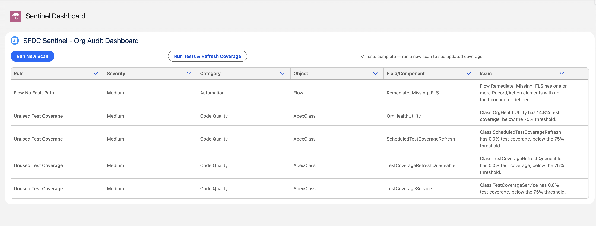

# SFDC Sentinel 🛡️

> An org health and compliance audit tool built natively on Salesforce — detecting security gaps, code quality issues, and automation risks across your org, with guided remediation built in.


---

## Demo

[▶ Watch the demo video](https://www.loom.com/share/7128d0044fe94595b3e640d053526ca4)



---

## What It Does

SFDC Sentinel continuously audits a Salesforce org for technical debt, security vulnerabilities, and automation risks. Findings are surfaced in a real-time LWC dashboard, and admins can remediate issues directly via guided Screen Flows — without writing code.

### Audit Rules (v1)

| Rule | Severity | Category | Detection Method |
|---|---|---|---|
| Missing Field Level Security | High | Security | SOQL on FieldPermissions — flags custom fields with zero access grants across all profiles/permission sets |
| Low Test Coverage | Medium | Code Quality | Tooling API → ApexCodeCoverageAggregate — flags Apex classes below 75% threshold |
| Flow No Fault Path | Medium | Automation | Tooling API → Flow metadata — flags active flows with record/action elements and no fault connector |
| SOQL In Loop | High | Code Quality | Tooling API → ApexClass body — regex static analysis detecting SOQL inside for/while loops |

---

## Architecture

```
┌─────────────────────────────────────────────────────────┐
│                    LWC Dashboard                         │
│  auditDashboard (empApi subscriber + datatable)          │
└──────────────────────┬──────────────────────────────────┘
                       │ @AuraEnabled
┌──────────────────────▼──────────────────────────────────┐
│              AuditDashboardController                    │
│  startScan() → enqueueJob()                              │
│  getFindings() → latest scan from Audit_Finding__c       │
└──────────────────────┬──────────────────────────────────┘
                       │ System.enqueueJob()
┌──────────────────────▼──────────────────────────────────┐
│           AuditRuleEngineQueueable                       │
│  implements Queueable, Database.AllowsCallouts           │
│  → reads Audit_Rule__mdt (config-driven)                 │
│  → calls AuditRuleEngine.runSingleRulePublic()           │
│  → publishes Audit_Progress__e (Platform Event)          │
│  → inserts Audit_Finding__c records                      │
└──────────────────────┬──────────────────────────────────┘
                       │ Type.forName() + newInstance()
┌──────────────────────▼──────────────────────────────────┐
│              AuditRuleEngine                             │
│  Config-driven via Audit_Rule__mdt                       │
│  Dynamically instantiates IAuditRule implementations     │
└──────┬──────────────┬──────────────┬────────────────────┘
       │              │              │              │
  MissingFLS    UnusedTest     FlowNoFault     SOQLInLoop
  Rule          CoverageRule   PathRule        Rule
  (SOQL)        (Tooling API)  (Tooling API)   (Tooling API)
                       │
              Named Credential
              OAuth 2.0 Client Credentials Flow
              → Sentinel_Tooling_API
              → /services/data/v60.0/tooling/
```

### Key Design Decisions

**Config-driven rule engine** — `AuditRuleEngine` reads active rules from `Audit_Rule__mdt` and instantiates each class via `Type.forName()`. Adding a new audit rule requires writing one Apex class and adding one metadata record — zero changes to the engine itself.

**Queueable over Batch/Future** — chosen for flexibility: supports callouts (`Database.AllowsCallouts`), can chain jobs, and allows per-rule Platform Event publishing for live progress tracking.

**OAuth Client Credentials Flow** — Tooling API integration uses a proper Named Credential with Client Credentials Flow (not session ID), making it safe to package and install in other orgs without credential leakage.

**Platform Events for real-time UI** — each rule publishes `Audit_Progress__e` on completion; the LWC subscribes via `lightning/empApi`. No polling, no page refresh.

**Error isolation** — each rule runs inside a try/catch in the engine. One failing rule surfaces as its own finding instead of crashing the entire scan.

---

## Tech Stack

| Layer | Technology |
|---|---|
| Backend Logic | Apex (OOP — interface + implementations) |
| Async Processing | Queueable Apex |
| External Integration | Tooling API via REST, OAuth 2.0 Client Credentials Flow, Named Credentials |
| Real-time Updates | Platform Events + `lightning/empApi` |
| Configuration | Custom Metadata Types (`Audit_Rule__mdt`) |
| Data Persistence | Custom Object (`Audit_Finding__c`) |
| Frontend | Lightning Web Components (`@wire`, `refreshApex`, `empApi`) |
| Remediation | Screen Flow (declarative — no Apex required) |
| Testing | Apex Test Classes + HTTP Callout Mocks |
| Dev Tooling | Salesforce CLI, VS Code, Scratch Orgs, Source Tracking |

---

## Project Structure

```
force-app/main/default/
├── classes/
│   ├── IAuditRule.cls                       # Interface — all rules implement this
│   ├── AuditFinding.cls                     # Wrapper class for rule results
│   ├── AuditRuleEngine.cls                  # Config-driven engine (Type.forName)
│   ├── AuditRuleEngineQueueable.cls         # Async execution + Platform Event publishing
│   ├── AuditDashboardController.cls         # @AuraEnabled controller for LWC
│   ├── MissingFLSRule.cls                   # Rule 1: SOQL-based FLS check
│   ├── MissingFLSRuleTest.cls               # Test class for Rule 1
│   ├── UnusedTestCoverageRule.cls           # Rule 2: Tooling API coverage check
│   ├── UnusedTestCoverageRuleTest.cls       # Test class for Rule 2
│   ├── UnusedTestCoverageRuleMock.cls       # HTTP callout mock for Rule 2
│   ├── FlowNoFaultPathRule.cls              # Rule 3: Tooling API Flow metadata check
│   ├── FlowNoFaultPathRuleTest.cls          # Test class for Rule 3
│   ├── FlowNoFaultPathRuleMock.cls          # HTTP callout mock for Rule 3
│   ├── SOQLInLoopRule.cls                   # Rule 4: Static analysis via regex
│   ├── SOQLInLoopRuleTest.cls               # Test class for Rule 4
│   └── SOQLInLoopRuleMock.cls               # HTTP callout mock for Rule 4
├── lwc/
│   └── auditDashboard/                      # Main dashboard component
│       ├── auditDashboard.html              # Template with datatable + flow launcher
│       ├── auditDashboard.js                # Wire, empApi subscription, row actions
│       └── auditDashboard.js-meta.xml       # Exposed to App Builder
├── flows/
│   └── Remediate_Missing_FLS.flow-meta.xml  # Screen Flow for FLS remediation
└── objects/
    ├── Audit_Finding__c/                    # Persisted scan results
    ├── Audit_Progress__e/                   # Platform Event for live progress
    └── Audit_Rule__mdt/                     # Rule configuration (config-driven)
```

---

## Installation

### Prerequisites

- Salesforce CLI (`sf`) installed — [Install guide](https://developer.salesforce.com/tools/salesforcecli)
- A Salesforce Developer Edition org with Dev Hub enabled
- Git

### Step 1: Clone the repo and authenticate

```bash
git clone https://github.com/nishika2712/sfdc-sentinel.git
cd sfdc-sentinel/sfdc-sentinel
sf org login web --alias sentinel-dev --instance-url https://login.salesforce.com
sf config set target-org sentinel-dev
```

### Step 2: Create a scratch org

```bash
sf org create scratch \
  --target-dev-hub sentinel-dev \
  --alias sentinel-scratch \
  --duration-days 30 \
  --definition-file config/project-scratch-def.json
sf config set target-org sentinel-scratch
```

### Step 3: Deploy all metadata

```bash
sf project deploy start --source-dir force-app/main/default
```

### Step 4: Configure the Named Credential (OAuth integration)

The Tooling API integration uses OAuth 2.0 Client Credentials Flow. After deploying:

1. **Create an External Client App** — Setup → App Manager → New External Client App
   - Enable OAuth, select scope: `api`
   - Enable Client Credentials Flow, set Run As to your admin user
   - Copy the Consumer Key and Consumer Secret

2. **Create an External Credential** — Setup → Named Credentials → External Credentials → New
   - Protocol: OAuth 2.0
   - Flow: Client Credentials with Client Secret Flow
   - Identity Provider URL: `https://<your-org-domain>/services/oauth2/token`
   - Add a Principal with your Consumer Key and Secret

3. **Create a Named Credential** — Setup → Named Credentials → New
   - URL: `https://<your-org-domain>`
   - External Credential: select the one you just created
   - Generate Authorization Header: checked

4. **Create a Permission Set** granting External Credential Principal access → assign it to your user

### Step 5: Add a Remote Site Setting

Setup → Remote Site Settings → New
- Name: `Self_Tooling_API`
- URL: your org's My Domain URL

### Step 6: Add the dashboard to a Lightning App Page

Setup → Lightning App Builder → New → App Page → drag `auditDashboard` component onto the canvas → Save → Activate

---

## Running Tests

```bash
sf apex run test --code-coverage --result-format human
```

All 5 test classes use proper HTTP callout mocks — no real org callouts or external dependencies during test execution.

Expected output: 5 passing tests, 0 failures.

---

## What Each Rule Detects (and Why It Matters)

**Missing Field Level Security**
Custom fields with no FLS configured are invisible in the Salesforce UI by default but fully accessible via API. This is a common compliance gap in orgs that add fields rapidly without following a security review process. The rule queries `FieldPermissions` directly — if no permission set or profile grants Read or Edit on a field, it's flagged as High severity.

**Low Test Coverage**
Classes below the 75% threshold are a production deployment blocker, but more importantly they indicate untested business logic that's a regression risk. This rule queries `ApexCodeCoverageAggregate` via the Tooling API — the same dataset Salesforce uses for org-wide coverage calculations. Anonymous Apex and test classes are excluded from results.

**Flow No Fault Path**
Active flows with Create Records, Update Records, Delete Records, or Action Call elements but no fault connector fail silently in production — leaving data in inconsistent states with no error notification to admins. This is one of the most common causes of mysterious org data issues. The rule fetches each active Flow's full metadata definition via the Tooling API and inspects element structure for missing `faultConnector` entries.

**SOQL In Loop**
SOQL queries inside loops are the most common cause of `System.LimitException: Too many SOQL queries: 101` errors in production. Detected via regex static analysis on Apex class bodies fetched through the Tooling API — flags any class where a `[SELECT` keyword appears within 300 characters after a `for` or `while` loop opening brace. Test classes and mock classes are excluded.

---

## Remediation Flow

For Missing Field Level Security findings, SFDC Sentinel includes a built-in guided remediation path via a Screen Flow launched inline in the dashboard:

1. **Select a finding** — filtered to show only FLS findings from the latest scan
2. **Choose a Permission Set** — filtered to exclude profile-based system sets that don't support DML
3. **Confirmation screen** — shows exactly what access will be granted
4. **Automatic resolution** — flow checks whether object-level access already exists (Decision element) before creating it, then grants field-level Read + Edit access
5. **Verify** — run a new scan to confirm the finding is resolved

The entire remediation is declarative — no Apex, no code deployment required for an admin to fix the issue.

---

## Roadmap (v2)

- [ ] Hardcoded IDs rule — detect `Id` literals in Apex class bodies
- [ ] Missing Sharing Model rule — flag classes without `with sharing` keyword
- [ ] Scan history trend chart — LWC recharts showing org health score over time
- [ ] Email notification on critical findings — Schedulable Apex + OrgWideEmailAddress
- [ ] Scheduled auto-scan — Schedulable Apex wrapper around the Queueable engine
- [ ] 2GP unlocked package — installable in any org via package version URL

---

## Author

**Nishika Jain**
Technical Consultant @ Salesforce | Agentforce Specialist

[LinkedIn](YOUR_LINKEDIN_URL) · [GitHub](https://github.com/nishika2712)

---

## License

MIT
